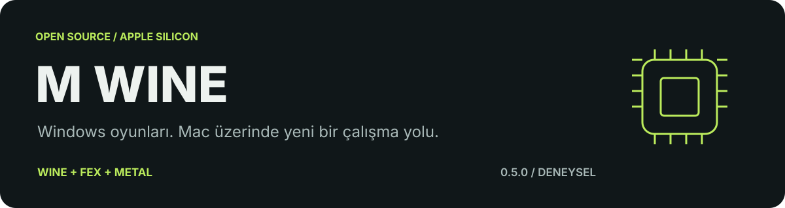
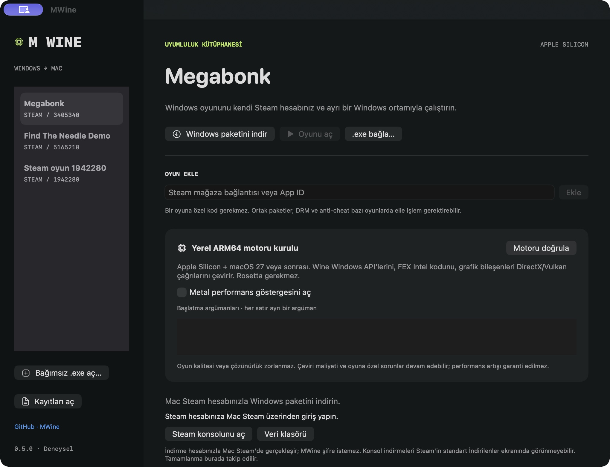
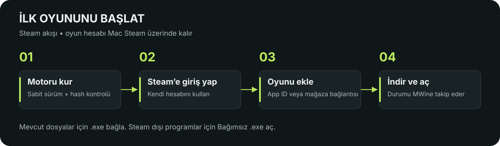
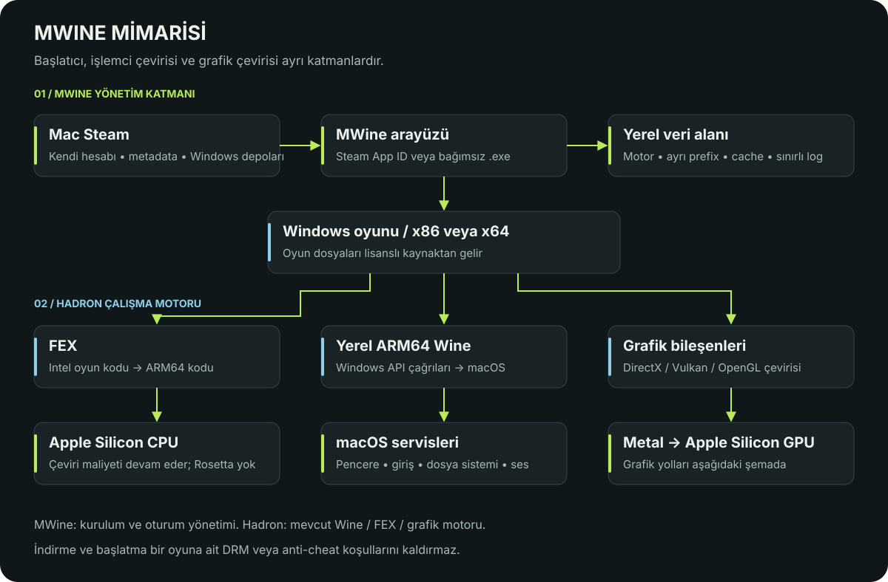
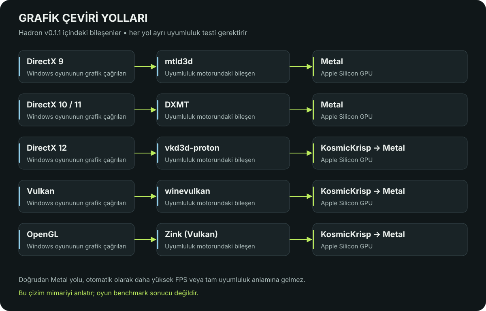

<p align="center">
  
</p>

<p align="center">
  <a href="https://github.com/halismertkir/MWine/actions/workflows/ci.yml"></a>
  <a href="LICENSE"></a>
  
  
  
</p>

<p align="center">
  <a href="#hızlı-başlangıç">Hızlı başlangıç</a> ·
  <a href="#mimari">Mimari</a> ·
  <a href="#uyumluluk-ve-testlerin-sınırı">Uyumluluk</a> ·
  <a href="CONTRIBUTING.md">Katkı</a> ·
  <a href="mailto:contact@halismertkir.com">İletişim</a>
</p>

# MWine

**Windows oyunlarını Apple Silicon Mac üzerinde çalıştırmak için açık kaynaklı,
genel amaçlı, deneysel bir uyumluluk başlatıcısı.**

Steam mağaza bağlantısıyla oyun ekleyin, Windows paketlerini kendi Mac Steam
hesabınızla indirin ve ayrı bir Windows ortamında başlatın. Steam dışı programlar
için kendi `.exe` dosyanızı da seçebilirsiniz. Uygulama kaynak proje klasörüne
bağlı olmadan taşınabilir.

> [!IMPORTANT]
> **0.5.0 deneysel sürümdür.** Bütün oyunlarla uyumluluk veya Windows ile aynı FPS
> garanti edilmez. Yerel yol Rosetta kullanmaz; FEX Intel oyun kodunu çevirir.
> macOS 27+ gerekir. Henüz notarize edilmiş bir binary release bulunmuyor.

## Uygulama ekranı

<p align="center">
  
</p>

*Gerçek MWine 0.5.0 arayüzü. Görsel, oyun performansı veya uyumluluk sonucu değildir.*

| Ne yapar? | Nasıl? |
| --- | --- |
| Oyun ekler | Steam App ID, mağaza bağlantısı veya yerel `.exe` |
| Windows paketini indirir | Mac Steam konsolu; kendi hesabınız ve oyun lisansınız |
| Oyunları ayrı tutar | Oyun başına Windows ortamı, shader/JIT cache ve oturum kayıtları |
| Kaynakları korur | En fazla 8 MiB oturum çıktısı; kritik baskıda yalnızca ilgili prefix durdurulur |
| Taşınabilir çalışır | Uygulama kaynakları bundle içinde; veriler Application Support altında |

## Gereksinimler

- Apple Silicon Mac (M1 veya sonrası).
- Yerel motor için **macOS 27 veya sonrası**. Arayüz macOS 14+ için derlenir;
  eski sistemlerde bu yerel motorla oyun başlatılamaz.
- Kaynaktan derlemek için Xcode Command Line Tools ve Swift derleyicisi.
  İlk kurulum: `xcode-select --install`.
- Steam oyunları için resmi **Mac Steam**, oturum açılmış kendi hesabınız ve
  oyunun indirme lisansı. MWine hesap şifresi istemez.
- Motorun kurulumu için en az 2,5 GB geçici boş alan; kurulu motor yaklaşık
  1,1 GB. Her yeni Windows ortamı yaklaşık 1 GB ek alan kullanabilir.
  Oyunlar, shader/JIT önbellekleri ve birleşen paketler ayrıca yer kaplar.

## Hızlı başlangıç



```sh
git clone https://github.com/halismertkir/MWine.git
cd MWine
./scripts/test
./scripts/build-app
open build/MWine.app
```

Derleme oyun veya uyumluluk motoru indirmez. `MWine.app` dosyasını Applications
klasörüne kopyalayabilirsiniz. Bu yerel derleme ad hoc imzalıdır; Apple tarafından
notarize edilmiş bir dağıtım değildir. İndirilmiş bir derlemede macOS güvenlik
kontrolü çıkarsa sistemin “Yine de Aç” akışını kullanın; güvenlik ayarlarını topluca
kapatmayın. Henüz public, notarize edilmiş bir binary release bulunmuyor.

1. **Motoru kur**: sürümü sabitlenmiş Hadron paketi indirilir, SHA-256 ve kod
   imzası kontrol edilir. Kurulum arşivi başarıyla kurulunca silinir.
2. Mac Steam'i açın, hesabınıza giriş yapın.
3. **Oyun ekle** alanına Steam mağaza bağlantısını veya App ID girin.
4. **Windows paketini indir** düğmesine basın. MWine, Mac Steam'in konsoluna
   güncel public Windows depot komutlarını gönderir ve tamamlanmayı takip eder.
5. **Oyunu aç** düğmesine basın. Önceden indirdiğiniz bir oyun için **.exe bağla**
   da kullanılabilir. Yanlış başlatıcı seçildiyse doğru `.exe` dosyasını bağlayın.

Steam dışı, güvendiğiniz bir Windows programı için **Bağımsız .exe aç** seçeneğini
kullanın. Bu yol Steam kimliği veya Steam oturumu taklit etmez. Steam isteyen
bir oyunu bağımsız çalıştırmak DRM/oturum ihtiyacını kaldırmaz.

Başlatma argümanlarında her satır tek bir argümandır; shell komutu çalıştırılmaz.
Steam metadata'sındaki başlatma argümanları otomatik uygulanmaz; gerekiyorsa
oyunun resmi başlatma seçeneklerini burada girin. Birden fazla başlatıcısı olan
oyunlarda ilk uygun Windows `.exe` seçilir. Installer/redist betikleri otomatik
çalıştırılmaz; VC++/.NET gibi ek bağımlılıklar bazı oyunlarda elle kurulmalıdır.

Kütüphanedeki oyuna sağ tıklayıp **Kütüphaneden kaldır** diyebilirsiniz; bu işlem
oyun dosyalarını, Windows ortamını veya kayıtları silmez.

İndirme yüzdesi için tahmin üretilmez: Steam'in paket başlatma/tamamlama mesajları
izlenir. Konsol depot indirmeleri standart Steam **İndirilenler** ekranında
görünmeyebilir. MWine durum alanını veya **Steam konsolunu aç** düğmesini kullanın.
İndirme sırasında uygulama kapatılırsa Steam indirmeye devam edebilir; MWine
tekrar açıldığında kaydedilmiş işi takip eder. Steam logu yenilenirse yeniden
**Windows paketini indir** düğmesine basmak gerekir.

Komut satırıyla indirme (bu araç checkout altında çalışır):

```sh
./build/mwine-download 5165210
```

## Mimari



**MWine başlatma ve kurulum katmanıdır.** Steam metadata/depot işlemlerini,
motor doğrulamasını, izole ortamları ve oturum kayıtlarını yönetir. Windows API,
Intel kodu ve grafik çevirisini Hadron'un mevcut bileşenleri gerçekleştirir.
Yeni bir DirectX sürücüsü veya sıfır maliyetli Intel çeviricisi geliştirdiği
iddiasında bulunmaz.

### Grafik yolları



### Motor ve performans

| Katman | Kullanılan bileşen |
| --- | --- |
| Windows API | Yerel ARM64 Wine |
| Intel x86 / x64 oyun kodu | FEX ARM64EC / WoW64 |
| DirectX 10/11 | DXMT → Metal |
| DirectX 9 | mtld3d → Metal |
| DirectX 12 | vkd3d-proton → KosmicKrisp → Metal |
| Vulkan | winevulkan → KosmicKrisp → Metal |
| OpenGL | Zink → KosmicKrisp → Metal |

Bu yol Rosetta kullanmaz; FEX hâlâ Intel kodunu çevirir. Shader derlemesi,
senkronizasyon, oyun kodu ve grafik sürücüsü farkları takılmalara neden olabilir.
MWine oyun çözünürlüğünü/kalitesini düşürmez, CPU/GPU frekanslarını zorlamaz.
Kritik bellek/disk baskısında yalnızca o oyunun Windows ortamı durdurulur; başka
Wine ortamları kapatılmaz. Shader/JIT cache kullanılır; bunun bir oyundaki FPS kazancı ölçülmüş değildir.
Metal göstergesi geliştirici teşhisi içindir; her renderer için tam FPS ölçümü
sunacağı garanti edilmez.

Hadron v0.1.1 kaynağı, runtime SHA-256 ve bağımlılık revizyonları
`EngineConfig/` içindedir. İmzalı Wine loader ve provisioning profile korunur.
Mac Steam'in dosyalarına hook yazılmaz veya uygulama imzası değiştirilmez.
Downstream shell değişiklikleri `Patches/hadron/` içinde, BSD-3-Clause lisansıyla
korunur. Çalışan oyunlar patch hash'iyle ayrılmış değişmez runner dizinlerini
kullanır.

## Uyumluluk ve testlerin sınırı

Genel başlatıcı olmak, bütün oyunların çalıştığı anlamına gelmez. Kernel sürücüsü
isteyen anti-cheat, DRM, launcher, video codec, eksik Windows API'leri veya grafik
özellikleri çalışmayı engelleyebilir. DRM veya oyun lisansı atlatılmaz.

Otomatik indirme public, İngilizce / dil bağımsız Windows depolarını seçer; DLC,
shared depot ve şifreli/private branch kurulumları desteklenmez. Çakışan dosyalar
ve sembolik bağlantılar güvenli birleştirmeyi durdurur; elle kurulum kullanın.
Steam online API, Steam Cloud, başarımlar ve bütün oyunların giriş akışları
MWine'da doğrulanmış değildir.

Bu bilgisayarda önceki Rosetta/Vulkan motoruyla Find The Needle Demo'nun oyun
görüntüsü kullanıcı tarafından doğrulandı. Yerel ARM64 motorda x64 D3D11 cihaz
probu çalıştı. Bu sonuçlar yeni motorda oyun benchmark'ı veya genel uyumluluk
sertifikası değildir. Tam test kapsamı: [docs/VALIDATION.md](docs/VALIDATION.md).

## Veriler ve disk alanı

GUI verileri: `~/Library/Application Support/MWine/`.

- `bottles/`: oyun başına Windows ortamları ve kayıtlar.
- `runtime/`: motor, sürümlü runner ve önbellekler.
- `downloads/state/`: indirme işleri ve tamamlanma kayıtları.
- `games/`: çok paketli oyunların birleşmiş kopyaları. APFS clone mümkünse
  kullanılır; başka dosya sistemlerinde tam kopya ek alan tüketir.
- `logs/sessions/last-session.log`: en fazla 8 MiB oturum çıktısı.

Steam'in orijinal depot dosyaları kendi `steamapps/content/app_<id>/depot_<id>`
klasörlerinde kalır. MWine bunları otomatik silmez. Güncellemede önceki birleşmiş
oyun `games/<id>.previous-...` altında korunur; oyun klasöründeki kayıtları
kontrol ettikten sonra önceki kopyayı kendiniz silebilirsiniz. Disk temizliği
oyun kayıtlarıyla birlikte tüm veri klasörünü silmek anlamına gelmez.

`scripts/setup-runtime`, `setup-dxmt`, `setup-vulkan-game`, `mwine` eski prototipin
isteğe bağlı Rosetta araçlarıdır; GUI bunları kullanmaz. Windows Steam WebHelper
çözümleri deneyseldir, genel Steam giriş çözümü olarak sunulmaz.

## Lisans ve atıf

MWine'ın kendi kodu **Apache License 2.0** lisanslıdır: kişisel ve ticari kullanım,
değişiklik, satış ve dağıtım serbesttir. Dağıtımda lisans ve ilgili telif/atıf
bildirimleri korunmalıdır. `NOTICE` dosyasında **MWine** adı ve
**https://github.com/halismertkir/MWine** bağlantısı bulunur; türev dağıtımlarda
Apache 2.0 §4(d)'ye uygun okunabilir biçimde korunur. Bu atıf NOTICE, beraberinde
verilen dokümantasyon veya uygun bildirim ekranında yer alabilir; her ekranda
logo/rozet gösterme zorunluluğu yoktur.

Üçüncü taraflar kendi lisanslarına tabidir. Ayrıntılar:
[LICENSE](LICENSE), [NOTICE](NOTICE),
[THIRD_PARTY_NOTICES.md](THIRD_PARTY_NOTICES.md).

Motor ve oyunlar bu repoda veya derlenen uygulamada dağıtılmaz. Motoru ayrıca
dağıtırsanız LGPL/GPL bileşenlerinin kaynak sunumu dahil kendi yükümlülükleri
geçerlidir. Valve dosyaları Valve sunucularından alınır, açık kaynak lisansına
çevrilmez. MWine Valve/Apple/Hadron'un resmi ürünü değildir.

Katkılar için [CONTRIBUTING.md](CONTRIBUTING.md).

## Sorun bildirme ve iletişim

Hata bildirirken [GitHub Issues](https://github.com/halismertkir/MWine/issues)
kullanın. MWine sürümünü, macOS sürümünü, Apple çipini, oyunun App ID'sini ve
kişisel bilgilerden arındırılmış kısa bir oturum kaydını ekleyin.

**İletişim:** [contact@halismertkir.com](mailto:contact@halismertkir.com).
Güvenlik sorunlarını public issue yerine bu adrese bildirin; gerçek API
anahtarlarını, hesap tokenlarını veya şifreleri örnek olarak göndermeyin.
[Repo veri ve güvenlik kapsamı](SECURITY.md).
